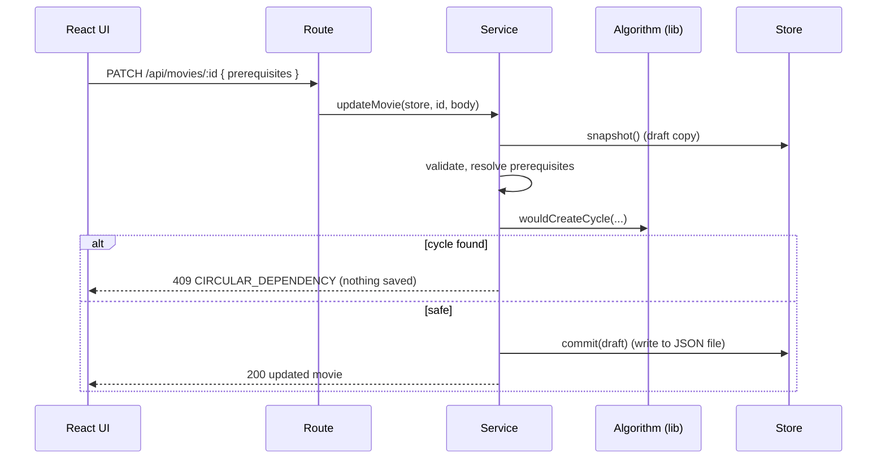
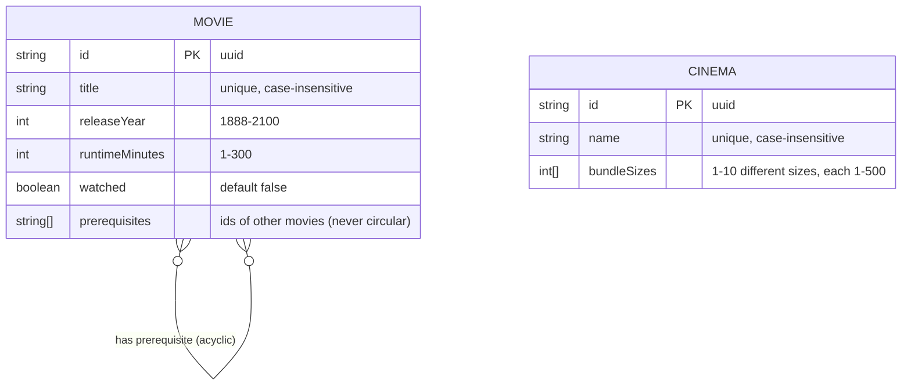

# Doomsday Ready

A small full-stack app that helps MCU fans **plan their rewatch before *Avengers: Doomsday*** and **book an opening-night watch party**.

Built for the **Blinto Talent Accelerator 2027 - Full Stack Developer Internship assessment**.

| | |
|---|---|
| **Backend** | Node.js + Express REST API under `/api` |
| **Frontend** | React 18 (Vite), three views: Movies, Rewatch Plan, Booking |
| **Storage** | In-memory state written through to a JSON file (atomic write) |
| **Tests** | Node's built-in test runner, 11 tests |
| **Bonus** | Docker Compose (one command) and a data model diagram |

---

## Table of contents

1. [Quick start](#1-quick-start)
2. [Using the app](#2-using-the-app)
3. [Features](#3-features)
4. [API reference](#4-api-reference)
5. [Architecture](#5-architecture)
6. [How the core algorithms work](#6-how-the-core-algorithms-work)
7. [Data model](#7-data-model)
8. [Frontend](#8-frontend)
9. [Testing](#9-testing)
10. [Docker](#10-docker)
11. [Decisions and assumptions](#11-decisions-and-assumptions)
12. [Limitations and what I would do next](#12-limitations-and-what-i-would-do-next)
13. [Project structure](#13-project-structure)
14. [Troubleshooting](#14-troubleshooting)
15. [How I used AI tools](#15-how-i-used-ai-tools)

---

## 1. Quick start

### Option A: Docker (one command)

Requires Docker with Compose.

```bash
docker compose up --build
```

| Service | URL |
|---|---|
| App (frontend) | http://localhost:8080 |
| API | http://localhost:4000/api |

The sample MCU data from the assessment, plus four sample cinemas, is loaded automatically the first time the database is empty. Data is kept in a Docker volume, so it survives restarts. To start fresh: `docker compose down -v`.

### Option B: Run locally (Node 18 or newer)

Use two terminals.

```bash
# Terminal 1 - API
cd backend
npm install
npm run seed      # optional: load the sample movies and cinemas
npm start         # http://localhost:4000/api
```

```bash
# Terminal 2 - frontend
cd frontend
npm install
npm run dev       # http://localhost:5173 (proxies /api to port 4000)
```

Open **http://localhost:5173**.

### Scripts

| Where | Command | What it does |
|---|---|---|
| `backend` | `npm start` | Start the API |
| `backend` | `npm run dev` | Start the API with auto-restart on file changes |
| `backend` | `npm run seed` | Load sample data (skipped if the database already has data) |
| `backend` | `npm test` | Run all 11 tests |
| `frontend` | `npm run dev` | Start the Vite dev server |
| `frontend` | `npm run build` | Build the production bundle into `dist/` |

### Environment variables (backend)

| Variable | Default | Meaning |
|---|---|---|
| `PORT` | `4000` | Port the API listens on |
| `DATA_FILE` | `backend/data/db.json` | Where data is saved |
| `SEED_ON_START` | unset | When `"true"`, sample data is loaded on start if the database is empty |

Frontend (dev only): `VITE_API_TARGET` (default `http://localhost:4000`) sets where the Vite dev server proxies `/api`.

**Reset the data:** stop the API, delete `backend/data/db.json`, then run `npm run seed` again. All ids change when you reseed.

---

## 2. Using the app

With the sample data loaded, these checks show every feature working.

### Movies tab
- Add a movie (title, year, runtime 1-300, optional prerequisites).
- Tick a movie to mark it as watched.
- Click **Edit prerequisites** on a movie, change the checkboxes, and **Save**.
- Try making *Avengers: Endgame* a prerequisite of *Iron Man*. The app shows a **circular dependency** error and nothing is changed.

### Rewatch Plan tab
- Pick **Avengers: Doomsday**: 7 movies to watch, "0 of 7 watched", remaining time 1000 min (16h 40m).
- Tick movies in the list: the progress bar, the count and the remaining time update.
- Pick **Thor: Ragnarok**: no prerequisites, so the list is empty ("You're ready!").

### Booking tab

| Cinema | Bundles | Group size | Expected result |
|---|---|---|---|
| Blockbuster Hall | 1, 3, 4 | 6 | 2 bundles: 3 x 2 |
| Star Cineplex | 2, 5 | 11 | 4 bundles: 5 x 1, 2 x 3 |
| Grand Premiere | 6, 9, 20 | 44 | 4 bundles: 20 x 1, 9 x 2, 6 x 1 |
| Odd Seats Cinema | 4, 6 | 7 | Not possible |

You can also add your own cinema (name and sizes such as `2, 5`).

---

## 3. Features

### Feature 1 - Movies and rewatch order
- A movie has a **unique title** (case-insensitive), a release year, a **runtime of 1-300 minutes**, optional **prerequisites**, and a **watched** flag (default `false`).
- Prerequisites and `watched` can be changed later with `PATCH`.
- **A movie can never depend on itself**, directly or through other movies. Any create or update that would cause this is rejected with **`409 CIRCULAR_DEPENDENCY`**, and nothing is saved.
- **Rewatch order** for a target movie returns every transitive prerequisite exactly once, each after its own prerequisites, never including the target. It also returns how many of them are watched and the **total runtime of the unwatched ones**.

### Feature 2 - Cinemas and watch-party booking
- A cinema has a **unique name** and **1 to 10 different bundle sizes** (each 1-500 seats).
- A **booking quote** for a group of 1-10,000 returns the **fewest bundles whose seats add up to exactly the group size** (nobody pays for an empty seat) with how many of each size to buy, or says it is **not possible**.

### Feature 3 - Frontend
Three views (Movies, Rewatch Plan, Booking) that use the API. See [section 8](#8-frontend).

### Bonus items
- Data model diagram: [section 7](#7-data-model).
- Docker Compose: [section 10](#10-docker).

---

## 4. API reference

All endpoints are under `/api`. Request and response bodies are JSON.

| Method and path | Purpose | Success |
|---|---|---|
| `GET /health` | Health check | `200` |
| `POST /movies` | Create a movie, or an array of movies (all-or-nothing) | `201` |
| `GET /movies` | List movies | `200` |
| `GET /movies/:id` | Get one movie *(extra)* | `200` |
| `PATCH /movies/:id` | Update title, year, runtime, prerequisites or watched | `200` |
| `DELETE /movies/:id` | Delete a movie and remove it from others' prerequisites *(extra)* | `204` |
| `GET /movies/:id/rewatch-order` | Rewatch order (feature 1) | `200` |
| `POST /cinemas` | Create a cinema, or an array of cinemas | `201` |
| `GET /cinemas` | List cinemas | `200` |
| `GET /cinemas/:id` | Get one cinema *(extra)* | `200` |
| `GET /cinemas/:id/booking?groupSize=6` | Booking quote (feature 2) | `200` |

> Movie ids and cinema ids are different lists. A movie id used in a cinema URL returns `404`.

### Field rules

**Movie**

| Field | Type | Rule |
|---|---|---|
| `title` | string | required, unique (case-insensitive, trimmed), max 200 characters |
| `releaseYear` | integer | required, 1888-2100 |
| `runtimeMinutes` | integer | required, 1-300 |
| `prerequisites` | string[] | optional; movie ids **or titles**; stored as ids; duplicates ignored |
| `watched` | boolean | optional, default `false` |

**Cinema**

| Field | Type | Rule |
|---|---|---|
| `name` | string | required, unique (case-insensitive, trimmed), max 100 characters |
| `bundleSizes` | integer[] | required, 1 to 10 items, each 1-500, no duplicates |

**Booking query:** `groupSize` must be a whole number from 1 to 10,000.

### Errors

Every error has the same shape:

```json
{ "error": { "code": "CIRCULAR_DEPENDENCY", "message": "...", "details": ["..."] } }
```

| Status | Code | When |
|---|---|---|
| 400 | `VALIDATION_ERROR` | a field is missing or out of range (`details` lists every problem) |
| 400 | `UNKNOWN_PREREQUISITE` | a prerequisite matches no movie (`details` lists them) |
| 400 | `INVALID_JSON` | the request body is not valid JSON |
| 404 | `NOT_FOUND` | the movie, cinema or route does not exist |
| 409 | `CIRCULAR_DEPENDENCY` | the change would make a movie depend on itself |
| 409 | `DUPLICATE_TITLE` | a movie with this title already exists |
| 409 | `DUPLICATE_NAME` | a cinema with this name already exists |
| 500 | `INTERNAL_ERROR` | unexpected server error (details are logged, not sent) |

### Examples

**Create a movie** (prerequisites can be titles or ids):

```bash
curl -X POST http://localhost:4000/api/movies \
  -H "Content-Type: application/json" \
  -d '{"title":"Iron Man 2","releaseYear":2010,"runtimeMinutes":124,"prerequisites":["Iron Man"]}'
```

```json
{
  "id": "5c9a...",
  "title": "Iron Man 2",
  "releaseYear": 2010,
  "runtimeMinutes": 124,
  "prerequisites": ["<iron-man-id>"],
  "watched": false
}
```

**Mark as watched:**

```bash
curl -X PATCH http://localhost:4000/api/movies/<id> \
  -H "Content-Type: application/json" -d '{"watched":true}'
```

**Circular dependency** (making Endgame a prerequisite of Iron Man):

```json
HTTP 409
{ "error": { "code": "CIRCULAR_DEPENDENCY",
             "message": "A movie cannot depend on itself, directly or through other movies" } }
```

**Rewatch order** - `GET /api/movies/<doomsday-id>/rewatch-order`:

```json
{
  "target": { "id": "...", "title": "Avengers: Doomsday" },
  "order": [
    { "id": "...", "title": "Iron Man", "runtimeMinutes": 126, "watched": false, "prerequisites": [], "releaseYear": 2008 },
    "... 6 more, each after its own prerequisites, ending with Avengers: Endgame ..."
  ],
  "totalCount": 7,
  "watchedCount": 0,
  "remainingMinutes": 1000
}
```

**Booking quote** - `GET /api/cinemas/<grand-premiere-id>/booking?groupSize=44`:

```json
{
  "cinemaId": "...", "cinemaName": "Grand Premiere", "groupSize": 44,
  "bundleSizes": [6, 9, 20],
  "possible": true,
  "totalBundles": 4,
  "breakdown": [ { "size": 20, "count": 1 }, { "size": 9, "count": 2 }, { "size": 6, "count": 1 } ]
}
```

**Not possible** (`groupSize=7` on a cinema with bundles 4 and 6) is an ordinary answer, so it returns `200`:

```json
{ "possible": false, "groupSize": 7, "message": "No combination of bundles adds up to exactly 7 seats", "...": "..." }
```

---

## 5. Architecture

```
React UI  ->  /api  ->  Express routes  ->  services  ->  lib (algorithms)
                                               |
                                             store (memory + JSON file)
```

| Layer | Files | Responsibility |
|---|---|---|
| Entry point | `server.js` | Reads environment variables, creates the store, optionally seeds, starts listening |
| App setup | `app.js` | CORS, JSON parsing, routes, 404 handler, **central error handler** |
| Routes | `routes/index.js` | HTTP only: pass the request to a service and send back the result |
| Services | `services/movieService.js`, `cinemaService.js` | Business rules: uniqueness, resolving prerequisites, calling the algorithms, building responses |
| Validation | `validation.js` | Shape and range checks for all input |
| Algorithms | `lib/graph.js`, `lib/bundles.js` | Pure functions, no HTTP and no storage |
| Storage | `store.js` | In-memory state with write-through to a JSON file |
| Errors | `errors.js` | `ApiError` (status, code, message, details) |

### Request flow



### Draft and commit (why a rejected request changes nothing)

Every write follows the same steps:

1. `store.snapshot()` makes a deep copy of the data (the draft).
2. The service validates and changes the draft only.
3. If any rule fails, an `ApiError` is thrown and the draft is discarded. The real data and the file were never touched.
4. If everything passes, `store.commit(draft)` replaces the real data and saves it.

The file is saved by writing a temporary file and renaming it over the real one, so a crash during a save can never leave a half-written file. Batch creation (arrays) uses the same draft, so it is all-or-nothing.

### Central error handling

Services throw `ApiError`. One error-handling middleware in `app.js` turns every error into the same JSON shape: expected errors keep their status and message, bad JSON becomes `400 INVALID_JSON`, and anything unexpected is logged on the server and returned as a generic `500` so no internals are leaked.

---

## 6. How the core algorithms work

Features 1 and 2 are implemented by hand in `backend/src/lib/`, with no graph, dynamic programming or algorithm libraries, as the brief requires.

### 6.1 Circular dependency detection (`graph.js`)

Movies are nodes. "A needs B" is an edge `A -> B`.

When movie `M` is given a new list of prerequisites, a cycle appears **if and only if `M` can be reached from one of those prerequisites by following prerequisite edges** (or one of them is `M` itself). The function runs an iterative depth-first search starting from the new prerequisites and looks for `M`.

Example: make *Endgame* a prerequisite of *Iron Man*.
Endgame -> Infinity War -> Civil War -> The Avengers -> **Iron Man**. Iron Man is reached, so the answer is `409 CIRCULAR_DEPENDENCY`.

- Time **O(V + E)**, space **O(V)**.
- On create, a new movie has no dependants yet, so the only possible cycle is naming itself.

### 6.2 Rewatch order (`graph.js`)

A depth-first **post-order** walk from the target (a movie is added to the answer only after all of its prerequisites) is a valid topological order.

- A `visited` set makes every movie appear **exactly once**, even when it is reachable by several paths.
- The target is excluded.
- It uses an explicit stack instead of recursion, so a very long chain cannot overflow the call stack. A test uses a 50,000-movie chain.

Example: *Civil War* needs *The Avengers*, which needs *Iron Man* and *The First Avenger*. Result: `Iron Man, The First Avenger, The Avengers`.

The service then adds `totalCount`, `watchedCount` and `remainingMinutes` (the sum of runtimes of the unwatched movies).

- Time **O(V + E)**, space **O(V)**.

### 6.3 Booking quote (`bundles.js`)

"Fewest bundles that add up to exactly `n` seats" is the **unbounded coin-change** problem, solved with dynamic programming.

- `dp[i]` = the fewest bundles to seat exactly `i` people (`Infinity` if impossible), with `dp[0] = 0`.
- `dp[i] = 1 + min(dp[i - size])` over every bundle size that fits.
- `pick[i]` remembers the last bundle used, so the answer can be rebuilt by walking back from `n`.
- If `dp[n]` is still `Infinity`, no exact combination exists, and the API answers `possible: false`.

**Greedy does not work.** For sizes `1, 3, 4` and a group of `6`, greedy takes `4 + 1 + 1` (3 bundles), but the optimum is `3 + 3` (2 bundles).

Worked example for sizes `[1, 3, 4]`, group `6`:

| seats | best count | last bundle |
|---|---|---|
| 0 | 0 | - |
| 1 | 1 | 1 |
| 2 | 2 | 1 |
| 3 | 1 | 3 |
| 4 | 1 | 4 |
| 5 | 2 | 4 |
| 6 | **2** | 3 |

Walking back from 6: `3`, then `3`. Result: **3 x 2**.

- Time **O(n x sizes)**, at most 10,000 x 10 steps. Space **O(n)**.
- When several answers have the same minimum count, the result is deterministic (sizes are tried largest first).

---

## 7. Data model



- `MOVIE` points to other `MOVIE`s through `prerequisites`: a self-referencing many-to-many relationship that must stay a directed acyclic graph (DAG).
- `CINEMA` is independent. A booking quote is calculated on the fly from `bundleSizes` and the requested group size, so **no booking is stored**.

Stored file (`backend/data/db.json`):

```json
{
  "movies": [
    { "id": "...", "title": "Iron Man", "releaseYear": 2008, "runtimeMinutes": 126, "prerequisites": [], "watched": false }
  ],
  "cinemas": [
    { "id": "...", "name": "Grand Premiere", "bundleSizes": [6, 9, 20] }
  ]
}
```

Prerequisites are stored as **ids**, not titles, because titles can change.

---

## 8. Frontend

React 18 built with Vite. No router, no state library and no UI kit: three views only need `useState` and `useEffect`.

| File | Role |
|---|---|
| `src/api.js` | The only place that calls the backend. One `request()` helper adds the JSON header, handles `204`, and turns error responses into `Error` objects with the server's message and code |
| `src/App.jsx` | Holds the shared `movies` and `cinemas` state, loads both with `Promise.all`, draws the tabs, and shows a banner if the API is unreachable |
| `src/views/MoviesView.jsx` | Add movies, tick watched, edit prerequisites (shows the circular-dependency error) |
| `src/views/RewatchView.jsx` | Pick a target, ordered list with watched ticks, progress bar ("4 of 7 watched"), remaining time |
| `src/views/BookingView.jsx` | Pick a cinema, enter a group size, see the bundles or "Not possible"; add a cinema |
| `src/styles.css` | Dark theme styles |

The frontend calls `/api/...` with a relative URL. In development, Vite proxies it to port 4000. In Docker, nginx proxies it to the API container. No address is hard-coded, and there are no CORS issues in the browser.

---

## 9. Testing

```bash
cd backend
npm test
```

Expected: `# pass 11`, `# fail 0`. The tests use Node's built-in runner (no extra packages) and an in-memory store, so they never touch `db.json`.

**`test/logic.test.js` - the algorithms directly (5 tests)**
- Booking: all four examples from the brief (6 -> 2 bundles, 11 -> 4, 44 -> 4, `[4, 6]` with 7 -> not possible).
- Booking: seats always add up exactly; the largest limits (10,000 seats with 500-seat bundles).
- Graph: cycle detection (self, indirect, and a safe change).
- Graph: each prerequisite appears once, in a valid order, and the target is excluded.
- Graph: a 50,000-movie chain does not overflow the stack.

**`test/api.test.js` - real HTTP requests to the app (6 tests)**
- Rewatch order examples from the brief (Doomsday returns 7 movies, Civil War returns 3, Ragnarok returns an empty list) and the remaining-minutes total.
- Ticking a movie as watched lowers the remaining time.
- Circular dependency returns `409 CIRCULAR_DEPENDENCY` (indirect and self), and the data is unchanged afterwards.
- Movie validation (runtime 0 and 301, duplicate title ignoring case and spaces, default `watched`, self-reference on create, unknown id returns 404).
- Deleting a movie removes it from other movies' prerequisites.
- Cinema booking and validation (group size 0, 10001 and missing, unknown cinema, empty or oversized bundle lists, duplicate name).

### Manual testing

Use the checks in [section 2](#2-using-the-app), or call the API with curl or Postman using the examples in [section 4](#4-api-reference). Get ids from `GET /api/movies` and `GET /api/cinemas`.

---

## 10. Docker

`docker-compose.yml` starts two services:

| Service | Image | Port | Notes |
|---|---|---|---|
| `api` | built from `backend/Dockerfile` (Node 20 Alpine) | 4000 | `SEED_ON_START=true`; data in the `api-data` volume at `/data/db.json` |
| `web` | built from `frontend/Dockerfile` (build with Node, serve with nginx) | 8080 | nginx serves the built React app and proxies `/api/` to `api:4000` |

```bash
docker compose up --build     # start everything
docker compose down           # stop (data is kept)
docker compose down -v        # stop and delete the data volume
```

---

## 11. Decisions and assumptions

Where the brief was unclear, I made these choices:

- **Technology stack:** the brief only requires React. I chose Node.js and Express for the backend so the whole project is JavaScript.
- **"Release year and runtime in minutes: 1-300":** I applied the 1-300 range to the **runtime**. Release year must be an integer from 1888 (the first film) to 2100.
- **Field names:** `title`, `releaseYear`, `runtimeMinutes`, `prerequisites`, `watched` for movies; `name`, `bundleSizes` for cinemas.
- **Prerequisites** can be sent as movie ids or titles (handy for bulk creation and seeding). They are stored as ids, and duplicates are ignored.
- **Uniqueness** of movie titles and cinema names is case-insensitive and ignores surrounding spaces.
- **Duplicate bundle sizes** (for example `[2, 2, 5]`) are rejected with `400`, because the brief says "different bundle sizes".
- **"Not possible"** is a `200` response with `possible: false`, because it is a valid answer to the question. An invalid `groupSize` is a `400`.
- **Several optimal bookings** can exist. The API returns one deterministic optimal answer.
- **A movie can be changed after creation** for title, year, runtime, watched and prerequisites. Cinemas cannot be changed (the brief asks only to create and list them).
- **No users:** the brief mentions no accounts, so all data is shared, including the `watched` flag.
- **Storage:** a JSON file keeps setup at zero for reviewers and keeps the focus on the logic. All data access goes through `store.js`.
- **Extra endpoints** (`GET /movies/:id`, `DELETE /movies/:id`, `GET /cinemas/:id`, `GET /health`) were added. Deleting a movie also removes it from other movies' prerequisites. The UI has no delete button.
- **Sample data** comes from the brief (not an official watch guide). *Avengers: Doomsday*'s release year (2026) and runtime (150) are placeholders. Years and runtimes of the other films are the real ones.

---

## 12. Limitations and what I would do next

**Known limitations**
- JSON-file storage is fine for one server process but is not meant for many users or many server instances.
- No authentication. Watched status is shared by everyone.
- Switching tabs in the UI resets unsaved form input and the selected target.
- The UI has no loading indicator and no delete button.
- Lookups use array searches (`O(n)`), which is fine for small data.

**Next steps**
- Replace the JSON file with PostgreSQL (a join table for prerequisites) or MongoDB, with a unique index on title and a transaction around the cycle check.
- Add authentication and a per-user watched table; store real bookings.
- Add frontend tests (React Testing Library) and CI.
- Pagination, and optimistic UI updates for large lists.
- OpenAPI/Swagger documentation.

---

## 13. Project structure

```
doomsday-ready/
├── docker-compose.yml
├── README.md
├── TECHNICAL_ROUND_PREP.md
├── backend/
│   ├── Dockerfile
│   ├── package.json
│   ├── src/
│   │   ├── server.js            # entry point
│   │   ├── app.js               # middleware, routes, error handling
│   │   ├── store.js             # memory + JSON file, snapshot/commit
│   │   ├── errors.js            # ApiError
│   │   ├── validation.js        # input rules
│   │   ├── seed.js, seedData.js # sample data
│   │   ├── routes/index.js      # endpoints
│   │   ├── services/
│   │   │   ├── movieService.js  # movie rules
│   │   │   └── cinemaService.js # cinema rules + booking quote
│   │   └── lib/
│   │       ├── graph.js         # cycle detection + rewatch order
│   │       └── bundles.js       # booking dynamic programming
│   └── test/
│       ├── logic.test.js
│       └── api.test.js
└── frontend/
    ├── Dockerfile, nginx.conf
    ├── vite.config.js
    └── src/
        ├── main.jsx, App.jsx, api.js, styles.css
        └── views/ MoviesView.jsx, RewatchView.jsx, BookingView.jsx
```

---

## 14. Troubleshooting

| Problem | Cause and fix |
|---|---|
| `{"error":{"code":"NOT_FOUND","message":"Route not found"}}` | You opened a URL without `/api`, such as `http://localhost:4000/movies`. Use `http://localhost:4000/api/movies`. |
| "Could not reach the API" banner in the UI | The backend is not running on port 4000. Start it with `npm start` in `backend`. |
| Cinema booking URL returns `Cinema not found` | The id belongs to a movie, or the data was reseeded. Copy a fresh id from `GET /api/cinemas`. |
| `npm run seed` prints "already has data" | Seeding is skipped when data exists. Delete `backend/data/db.json` and run it again. |
| Port 4000 or 5173 already in use | Stop the other process, or set `PORT` (backend) or pass `--port` to Vite. |
| Docker: frontend shows an error | Wait for the `api` container to finish starting, then refresh. |

---

## 15. How I used AI tools

The assessment allows AI tools if their use is described. This is an accurate description of how I used them:

- I used **Claude (Anthropic's AI assistant)** extensively. From the assessment PDF, Claude generated the first complete version of this project: the Express API, the two core algorithms (cycle detection and rewatch order, and the bundle dynamic program), the React app, the tests, the Docker setup, and the first draft of this README and the technical-round notes.
- I did **not** use any library that solves features 1 and 2. The graph logic and the booking logic are plain JavaScript in `backend/src/lib/`.
- After generation, I ran the app and the test suite, tested the UI and the API by hand, and went through every source file line by line, with explanations, so that I understand how each part works and can explain and change it.
- Decisions about unclear parts of the brief are listed in [section 11](#11-decisions-and-assumptions).
